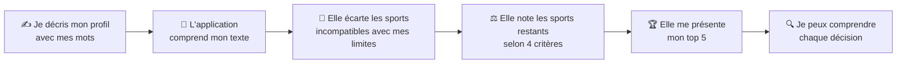
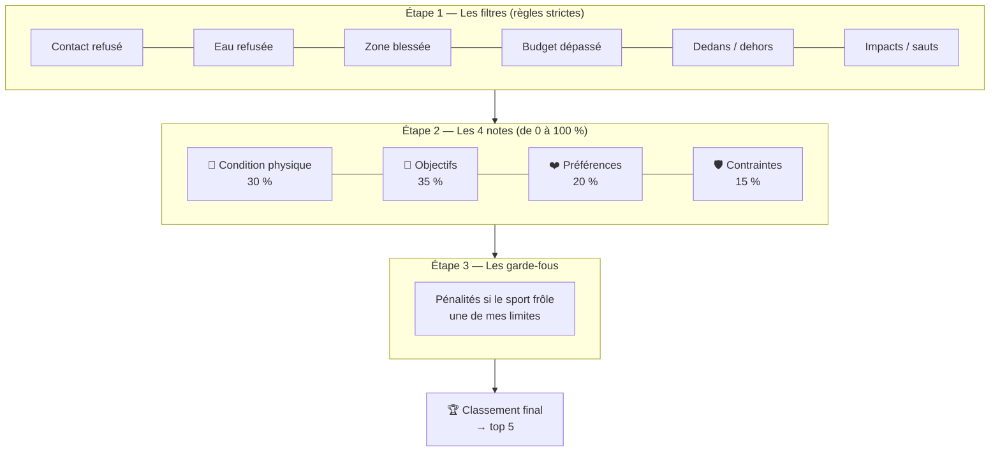
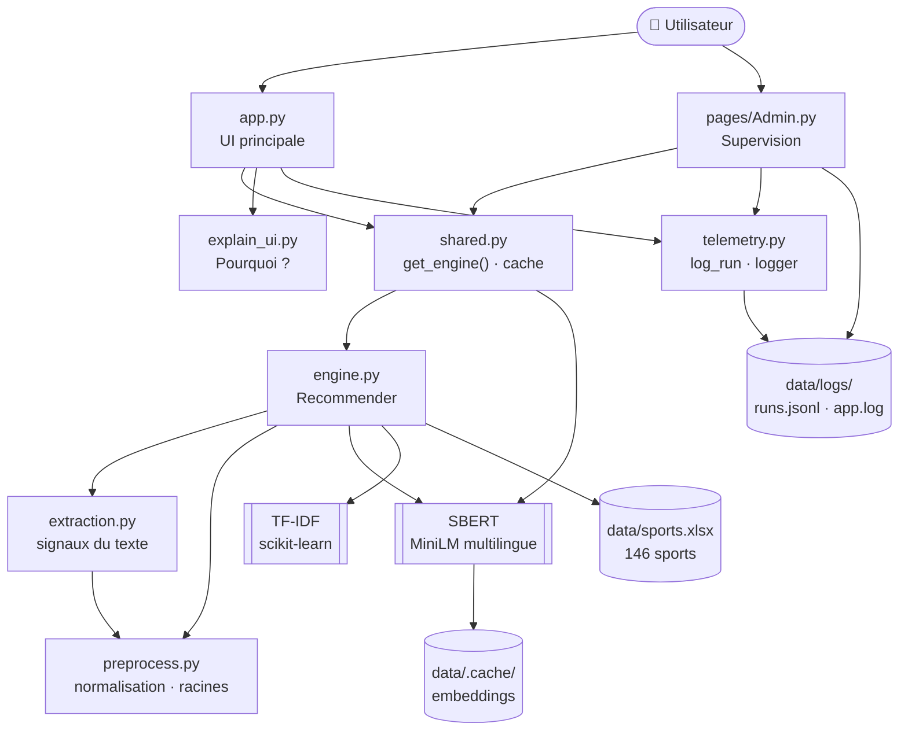
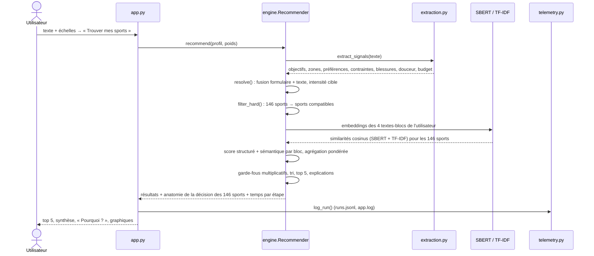
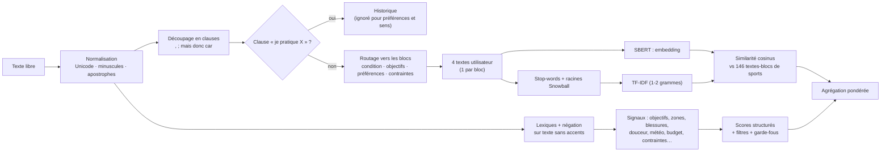

# 🏃 ECE-Projet-NLP — Recommandation intelligente d'activités sportives

> **Thème 7** — Recommandation d'activités sportives fondée sur l'analyse sémantique du profil physique et des objectifs personnels.
> L'utilisateur décrit son profil **avec ses propres mots** ; le système le comprend (NLP), le compare à 146 disciplines et
> propose un **top 5 expliqué**, avec la possibilité de voir *pourquoi* chaque sport est recommandé ou écarté.
>
> ⚠️ Outil d'aide à la **découverte** d'activités. Ce n'est ni un diagnostic médical ni une prescription d'exercices.

| | |
|---|---|
| **Entrée** | un texte libre + 4 échelles rapides (endurance, force, mobilité, motivation) + niveau + disponibilité |
| **Sortie** | top 5 des sports, scores par bloc, explications, visualisations, tableau de décision des 146 sports |
| **NLP** | prétraitement FR, extraction par lexiques + négation, SBERT multilingue, TF-IDF, similarité cosinus |
| **Stack** | Python 3.12 · Streamlit · sentence-transformers · scikit-learn · NLTK · pandas · Plotly |

---

## Sommaire

1. [Démarrage rapide](#1-démarrage-rapide)
2. [Architecture fonctionnelle](#2-architecture-fonctionnelle-comment-ça-marche-sans-technique)
3. [Architecture technique](#3-architecture-technique)
4. [Calculs détaillés](#4-calculs-détaillés)
5. [Données](#5-données)
6. [Panneau d'administration et tests](#6-panneau-dadministration-et-tests)
7. [Limites et pistes d'évolution](#7-limites-et-pistes-dévolution)

---

## 1. Démarrage rapide

```bash
pip install -r requirements.txt
streamlit run app.py
```

Le premier lancement télécharge le modèle SBERT (`paraphrase-multilingual-MiniLM-L12-v2`, ~470 Mo) et met en cache les
embeddings des 146 sports dans `data/.cache/`. Sans modèle (hors-ligne), l'application bascule automatiquement sur TF-IDF seul.

- **Page principale** : questionnaire → top 5 → section « Pourquoi ce résultat ? » → visualisations.
- **Bonus IA** (facultatif) : copiez `.env.example` en `.env` et renseignez votre clé Gemini gratuite. Détails dans la section 6ter.
- **Page Admin** (menu latéral) : supervision, logs, historique, tests. Mot de passe optionnel via `ADMIN_PASSWORD`.

---

## 2. Architecture fonctionnelle (comment ça marche, sans technique)

### 2.1 Le parcours de l'utilisateur



### 2.2 Ce que l'application comprend de mon texte

Je n'ai pas à cocher de cases : l'application lit mes phrases et en déduit ce qui compte.

| Ce que j'écris | Ce que l'application en déduit |
|---|---|
| « Je me fatigue vite quand je cours » | mon endurance est plus faible que ce que j'ai indiqué |
| « Je veux améliorer mon endurance et renforcer mon dos » | **objectifs** : endurance, force, zone du dos |
| « Je préfère les activités individuelles, en intérieur » | **préférences** : individuel, intérieur |
| « Je ne veux pas de sport de contact / je ne sais pas nager » | **contraintes strictes** : contact et eau exclus |
| « Je me suis blessé à l'épaule » | **blessure** : tout sport qui sollicite l'épaule est écarté |
| « Je cherche quelque chose de calme et doux » | **pratique douce** : l'intensité est plafonnée |
| « Mon budget est de 15 euros par séance » | **budget** : les sports trop chers sont écartés |
| « Je pratique le tennis » | simple **historique**, pas une préférence (le tennis n'est pas favorisé) |
| « Je ne veux pas d'activité dans l'eau » | la **négation** est comprise : l'eau n'est pas un goût |

### 2.3 Les trois étapes de décision



1. **Les filtres** retirent *avant tout calcul* les sports que je ne peux ou ne veux pas pratiquer. Un sport écarté n'est jamais classé.
2. **Les 4 notes** mesurent, pour chaque sport restant :
   - 💪 **Condition physique** : l'effort demandé est-il adapté à mon niveau ?
   - 🎯 **Objectifs** : le sport développe-t-il ce que je veux travailler ?
   - ❤️ **Préférences** : correspond-il à mes goûts (seul / équipe, intérieur / extérieur, type d'activité) ?
   - 🛡️ **Contraintes** : respecte-t-il mes limites (chocs, zones fragiles, budget, rythme) ?

   Chaque note combine **des règles** (comparaison avec les fiches du jeu de données) et **la ressemblance de sens** entre mon texte et la description du sport.
3. **Les garde-fous** réduisent le score d'un sport qui, sans être interdit, frôle une de mes limites (ex. : intensité trop haute pour une pratique douce).

### 2.4 Ce que je vois à l'écran


La section **« Pourquoi ce résultat ? »** permet de choisir *n'importe quel* des 146 sports :

| Statut | Ce que l'écran montre |
|---|---|
| ✅ **Recommandé** | graphique en cascade du score (apport de chaque bloc, pénalités, total), détail critère par critère (🟢🟠🔴) |
| 🟡 **Compatible mais non retenu** | l'écart avec le 5ᵉ sport, bloc par bloc : *pourquoi pas dans le top 5 ?* |
| ❌ **Écarté** | la ou les règles qui l'ont retiré, formulées en français, et la fiche du sport |

---

## 3. Architecture technique

### 3.1 Arborescence

```text
projet/
├── app.py                 # Page principale Streamlit (formulaire, top 5, visualisations)
├── pages/
│   └── Admin.py           # Centre de contrôle (runtime, logs, replay, carte PCA, labo, tests)
├── explain_ui.py          # Interface « Pourquoi ce résultat ? » (cascade, détail, comparaison)
├── engine.py              # Cœur : profil → filtrage → scores par blocs → pénalités → classement
├── extraction.py          # Extraction d'indices dans le texte (lexiques, négation, blessure, douceur…)
├── preprocess.py          # Normalisation, tokenisation, stop-words FR, racinisation Snowball
├── shared.py              # Chargement unique du modèle SBERT et du moteur (cache Streamlit)
├── telemetry.py           # Journalisation : runs (JSONL) + logs applicatifs
├── data/
│   ├── sports.xlsx        # dataset unique : 146 sports × 40 champs (+ feuille « Guide des champs »)
│   ├── .cache/            # embeddings SBERT mis en cache (non versionné)
│   └── logs/              # runs.jsonl, app.log (non versionnés)
├── .streamlit/config.toml
└── requirements.txt
```

### 3.2 Interaction entre les blocs



| Module | Responsabilité | Dépend de |
|---|---|---|
| `preprocess.py` | normaliser le texte (Unicode, minuscules), tokeniser, retirer les stop-words, raciniser | NLTK |
| `extraction.py` | repérer objectifs, zones, préférences, contraintes, blessures, douceur, budget ; router les clauses vers les blocs | `preprocess` |
| `engine.py` | résoudre le profil, filtrer, calculer scores structurés + sémantiques, pénaliser, classer, expliquer | `extraction`, `preprocess`, scikit-learn, pandas |
| `shared.py` | instancier **une seule fois** SBERT + moteur (`st.cache_resource`), repli TF-IDF si SBERT indisponible | `engine` |
| `explain_ui.py` | rendre la décision de chaque sport lisible (cascade, critères, comparaison avec le 5ᵉ) | `engine` |
| `telemetry.py` | écrire chaque run (profil, signaux, top 5, exclus, temps) et les logs | — |
| `app.py` / `Admin.py` | interfaces | tous les précédents |

### 3.3 Déroulé d'une requête



### 3.4 Pipeline NLP



| Technique | Où | Rôle |
|---|---|---|
| Normalisation Unicode, minuscules | `preprocess.normalize` | texte propre |
| Suppression des accents | `preprocess.fold` | lexiques robustes (« épaule » = « epaule ») |
| Stop-words FR + racinisation Snowball | `preprocess.preprocess` | entrée du TF-IDF |
| Lexiques regex + **détection de négation** | `extraction.extract_signals` | « pas de contact » ≠ « contact » |
| Distinction objectif / douleur / historique | `extraction` | « renforcer mon dos » ≠ « mal au dos » ≠ « je pratique le tennis » |
| **SBERT** (embeddings de phrases) | `engine._cached_embed` | sens du texte vs descriptions |
| **TF-IDF** + cosinus | `engine.sem_scores` | recoupement lexical (complément) |
| Phrase utilisateur la plus proche | `engine._best_sentences` | explicabilité sémantique |

### 3.5 Modèle de données de la décision

`Recommender.recommend()` renvoie un dictionnaire dont l'entrée `anatomy` contient, **pour chacun des 146 sports** :

```text
sport_id, name
retained        True/False            → a passé les filtres ?
rank, in_top    rang parmi les retenus, appartenance au top 5
excluded_why    [raisons]             → filtres déclenchés
blocks          {bloc: note 0–1}      → note finale du bloc
struct / sem    {bloc: 0–1}           → part « règles » et part « sens du texte »
weights         {bloc: poids normalisé}
contrib         {bloc: note × poids}  → apport au score (cascade)
base, pen_factor, pen_why             → score avant pénalités, facteur, raisons
criteria        {bloc: [(critère, 0–1)]}
```

C'est cette structure qui alimente l'écran « Pourquoi ? » **et** les logs : l'explication affichée est exactement le calcul réalisé.

---

## 4. Calculs détaillés

### 4.1 Score final

$$
\text{Score} \;=\; \underbrace{\frac{\sum_{b} w_b \, v_b}{\sum_{b} w_b}}_{\text{moyenne pondérée des blocs}} \;\times\; \underbrace{\prod_k \pi_k}_{\text{garde-fous}}
\qquad b \in \{\text{condition, objectifs, préférences, contraintes}\}
$$

| Bloc | Poids par défaut $w_b$ | Justification |
|---|---|---|
| 🎯 Objectifs | **35 %** | motif principal de la recherche |
| 💪 Condition physique | **30 %** | faisabilité et sécurité |
| ❤️ Préférences | **20 %** | adhésion à long terme |
| 🛡️ Contraintes | **15 %** | déjà traitées en amont par le filtrage dur |

Les poids sont réglables dans la barre latérale (renormalisés pour sommer à 100 %). Un bloc sans information (par exemple aucune
préférence exprimée) est ignoré et les poids restants sont renormalisés.

### 4.2 Note d'un bloc

$$
v_b = 0{,}4 \cdot S_b + 0{,}6 \cdot M_b
\qquad
M_b = 0{,}7 \cdot \text{minmax}\big(\cos_{\text{SBERT}}\big) + 0{,}3 \cdot \text{minmax}\big(\cos_{\text{TF-IDF}}\big)
$$

- $S_b$ : score **structuré** (règles, voir 4.3) ;
- $M_b$ : score **sémantique** ; le cosinus entre le texte utilisateur du bloc et le texte-bloc de chaque sport est normalisé
  (min-max) sur les 146 sports, car les cosinus SBERT sont tous dans une plage étroite ;
- si $S_b$ ou $M_b$ est absent, l'autre est utilisé seul.

### 4.3 Scores structurés $S_b$

**💪 Condition physique**

$$
S_{cond} = 0{,}4\,F_{cap} + 0{,}25\,F_{niv} + 0{,}2\,F_{int} + 0{,}15\,F_{freq}\qquad\text{(si vertiges ou instabilité signalés : } 0{,}35\,F_{cap} + 0{,}2\,F_{niv} + 0{,}2\,F_{int} + 0{,}1\,F_{freq} + 0{,}15\,F_{eq}\text{)}
$$

| Terme | Formule |
|---|---|
| $F_{cap}$ (exigences vs capacités) | $1-\operatorname{moy}_{c\in\{\text{endurance, force, souplesse}\}} \dfrac{\max\big(0,\;\text{req}_c-(\text{capacité}_c+1)\big)}{4}$ |
| $F_{niv}$ (difficulté vs niveau) | $1 - 0{,}35\cdot\max(0,\;\text{difficulté} - \text{difficulté tolérée})$ (1 pour débutant, 2 pour occasionnel, 3 au-delà) |
| $F_{int}$ (intensité vs cible) | $1-\Big(\dfrac{\max(0,\Delta-0{,}5)}{3}+\dfrac{\max(0,-\Delta-1)}{4}\Big)$ avec $\Delta=\text{intensité}-\text{cible}$ |
| $F_{freq}$ (fréquence vs effort) | $0{,}6$ si 2 séances par semaine ou moins et intensité ≥ 4, sinon $1$ |
| $F_{eq}$ (équilibre demandé vs stabilité signalée) | $1-0{,}2\cdot\max(0,\;\text{équilibre}-2)$, uniquement si vertiges ou instabilité sont déclarés |

L'**intensité cible** est $\text{clip}\big(1+0{,}5\cdot\text{endurance}+0{,}5\cdot\text{niveau}+0{,}25\cdot(\text{motivation}-3),\,1,\,5\big)$,
plafonnée à 2 si une pratique douce est demandée. Les capacités saisies sont ajustées de ±1 si le texte dit « je me fatigue vite »,
« bonne endurance », etc.

**🎯 Objectifs** : moyenne, sur chaque objectif détecté, d'un score de correspondance :
étiquette `objectifs` du sport (1,0) ; sinon capacité sollicitée / 5 (endurance, force, souplesse, équilibre, coordination) ;
règles dédiées (détente ↔ intensité ≤ 2, plein air ↔ extérieur, jeu collectif ↔ équipe/groupe…). Une zone du corps à travailler
compte pour $0{,}5+0{,}5\cdot\text{force}/5$ si le sport la sollicite, 0 sinon.

**❤️ Préférences** : moyenne de composantes à 1 ou 0 : format (individuel / duo / équipe / groupe), environnement,
familles d'activités aimées ; une famille ou un format rejeté dans le texte compte 0.

**🛡️ Contraintes (partie souple)** : moyenne de : impacts selon la tolérance, zones à ménager épargnées, contact (si refusé),
budget, rythme (séances fréquentes + effort/impacts élevés → 0,6).

### 4.4 Filtres stricts (avant tout score)

| Règle | Sport écarté si… |
|---|---|
| Contact refusé | contact physique intégré (niveau 2 ou 3 sur 3) |
| Eau refusée | catégorie aquatique / nautique / pagaie / rame / voile |
| Articulations fragiles | impacts = 3 (fréquents) |
| Sauts à éviter | catégorie « saut » |
| Intérieur (ou météo) / extérieur | sport pratiqué uniquement dans l'autre environnement |
| Articulation douloureuse | charge 2 ou 3 sur l'articulation concernée |
| Zone blessée | le sport sollicite cette zone et n'est pas très doux |
| Zone à ménager (déclarée) | zone sollicitée **et** (impacts = 3 ou force ≥ 4) |
| Budget | coût minimal de séance > plafond |
| Pratique douce | intensité ≥ 4 ou impacts = 3 |

### 4.5 Garde-fous multiplicatifs $\pi_k$

Ils empêchent qu'une limitation déclarée soit « diluée » dans la moyenne des blocs.

| Situation | Facteur |
|---|---|
| Articulations fragiles + impacts = 2 | ×0,85 |
| Articulations fragiles + sauts | ×0,85 |
| Impacts fréquents (tolérance moyenne) | ×0,92 |
| Zone à ménager sollicitée | ×(1 − 0,06 par zone) |
| Zone blessée sollicitée | ×0,8 |
| Articulation douloureuse, charge faible / modérée | ×0,92 / ×0,6 |
| Pratique douce + 3 articulations ou plus chargées (≥ 2) | ×0,85 |
| Pratique douce + intensité ≥ 4 / = 3 | ×0,75 / ×0,92 |
| Pratique douce + force ≥ 4 / sauts / impacts = 2 | ×0,9 / ×0,85 / ×0,92 |
| Intensité ≥ 4 alors que la cible ≤ 2,5 | ×0,9 |
| Débutant + difficulté d'entrée maximale | ×0,9 |
| Vertiges ou instabilité signalés + équilibre ≥ 4 | ×0,85 |
| Famille d'activités aimée non respectée | ×0,85 |
| Format souhaité non respecté | ×0,92 |

### 4.6 Classement

Tri par `(−score)`. Aucun assouplissement automatique : si peu de sports sont admissibles, le moteur ne réintroduit aucun sport exclu, et le chatbot indique les contraintes à reconsidérer (voir bonus B).

### 4.7 Exemple chiffré

Texte : *« Je me suis blessé à l'épaule, je cherche un sport calme et doux, en intérieur… »* → **Danse sportive standard** (n°1) :

| Bloc | Note | Poids | Apport |
|---|---|---|---|
| 💪 Condition physique | 69 % | 0,30 | +20,7 |
| 🎯 Objectifs | 23 % | 0,35 | +7,9 |
| ❤️ Préférences | 53 % | 0,20 | +10,6 |
| 🛡️ Contraintes | 67 % | 0,15 | +10,1 |
| 🚧 Garde-fous | | | −3,9 |
| **Score final** | | | **45,4 %** |

Cette décomposition est exactement celle du graphique en cascade de l'écran « Pourquoi ? ».

### 4.8 Performances

Une recommandation prend ~100 à 200 ms (embeddings des sports précalculés et mis en cache ; seul le texte utilisateur est encodé).
Le temps par étape (extraction, filtrage, embeddings + cosinus, scoring, explications) est consigné dans chaque run
et affiché dans la page Admin.

---

## 5. Données

`data/sports.xlsx` : **146 disciplines** × 40 champs, dataset unique (voir la feuille « Guide des champs »).

| Famille de champs | Exemples |
|---|---|
| Identité | `sport_id`, `nom_sport`, `categories` |
| Texte (pour le sémantique) | `description_fr`, `mots_cles`, `lieu_pratique` |
| Échelles ordinales 1–5 | `endurance`, `force`, `souplesse`, `coordination`, `equilibre`, `intensite_loisir` |
| Échelles 1–3 | `difficulte_entree`, `impacts` |
| Étiquettes multi-valeurs (`\|`) | `zones_corps_sollicitees`, `objectifs`, `format_pratique`, `environnement` |
| Contraintes | `contact`, `equipement`, budgets séance et matériel |

Pour le sémantique, chaque sport est décrit par **4 textes-blocs** générés à partir de ces champs (condition, objectifs,
préférences, contraintes), de sorte que chaque bloc de l'utilisateur est comparé à un texte de même nature.

**Articulations.** Chaque sport porte une charge de 0 à 3 sur neuf articulations (genoux, hanches, chevilles, pieds, lombaires, cervicales, épaules, coudes, poignets). Un sport qui sollicite surtout les muscles peut charger fortement une articulation : le ski alpin charge les genoux à 3/3 même si le geste principal sollicite les cuisses. Une douleur au genou exclut donc le ski, comme le football. La **mécanique du geste** (sauts, chutes, contacts, charges lourdes…), le **niveau de contact** (0 à 3) et la **sensibilité à la météo** complètent les contraintes.

> Les annotations sont celles d'un prototype pédagogique, **non validées médicalement**.

---

## 6. Panneau d'administration et tests

Page **Admin** (menu latéral) :

| Onglet | Contenu |
|---|---|
| 📡 Vue d'ensemble | sports les plus recommandés, signaux fréquents, motifs de filtrage, recoupement des méthodes |
| ⏱️ Runtime | temps par étape et par run, distribution des latences |
| 🗂️ Historique & replay | chaque run avec ses signaux ; **rejeu** avec le code actuel pour détecter les régressions |
| 📜 Logs | lecture en direct, filtres, téléchargement |
| 🗺️ Carte des sports | projection PCA des embeddings, texte utilisateur superposé |
| 🎛️ Labo de sensibilité | variation des poids et mouvement du classement (▲ ▼ 🆕) |
| ✅ Tests | **19 scénarios de cohérence** (contact, genou douloureux, pratique seul, genou fragile, ne sait pas nager, pas de contact, budget, blessure à l'épaule, tendinite au coude, combat, collectif, exemple de l'énoncé, vertiges, détente, salle, dos, équipe sans contact, pluie, budget nul) |
| 🧠 Modèles NLP | comparaison des 4 modèles (scénarios, précision, robustesse, latence, accord), historique des benchmarks, détail par intention, runs de production par modèle |
| 🧬 Dataset | statistiques et exploration des 146 sports |

Les runs sont écrits dans `data/logs/runs.jsonl` et les logs dans `data/logs/app.log` (non versionnés).

---

## 6bis. Comparaison des modèles NLP

L'application permet de choisir le modèle sémantique dans la barre latérale. Deux modèles sont comparés :

| Clé | Modèle | Rôle |
|---|---|---|
| `tfidf` | TF-IDF seul | référence lexicale, sans réseau de neurones |
| `minilm` | SBERT MiniLM multilingue (**défaut**) | embeddings multilingues légers |

**Mesures** (module `benchmark.py`, jeux de test dans `personas.py` et `gold.py`) :

- **Scénarios** : 19 contraintes strictes (genou fragile, pas de contact, budget…). Ces filtres ne dépendent pas du modèle.
- **Précision@5** : sur 14 intentions (« je veux me détendre », « sport de ballon en équipe »…), part du top 5 appartenant à la famille attendue.
- **Robustesse** : sur 5 groupes de 3 formulations d'une même intention, accord moyen des top 5 (indice de Jaccard).
- **Latence** moyenne et p95, temps de chargement, accord entre modèles.

**Résultats au moment de la rédaction** :

| Modèle | Scénarios | Précision@5 | Robustesse | Latence moyenne |
|---|---|---|---|---|
| TF-IDF seul | 19/19 | 0,64 | 0,32 | ~40 ms |
| SBERT MiniLM (défaut) | 19/19 | 0,71 | 0,41 | ~125 ms |

**Lecture honnête** : les contraintes ne départagent pas les modèles (elles sont traitées par des règles). Les écarts
de précision et de robustesse sont faibles, et le jeu compte 14 intentions : un écart inférieur à 0,05 n'est pas
significatif. SBERT MiniLM est retenu par défaut : il apporte un gain de précision et de robustesse par rapport au TF-IDF seul,
pour un surcoût de latence modeste. Le panneau Admin (onglet « 🧠 Modèles NLP ») permet de relancer le benchmark et d'élargir le jeu.

```bash
python benchmark.py   # exécution en ligne de commande
```

## 6ter. Bonus IA : explications et assistant conversationnel

Ces deux bonus **ne remplacent pas le moteur NLP** : l'application fonctionne intégralement sans eux.

### Bonus A : explication personnalisée d'une recommandation

Sous chaque sport recommandé, le bouton **« ✨ Expliquer avec l'IA »** demande à un modèle de langage de rédiger une
explication en français, à partir d'un dossier construit **uniquement** à partir des résultats du moteur : score global,
scores par bloc, critères forts et faibles, garde-fous, contraintes vérifiées, profil structuré. Le texte libre de
l'utilisateur n'est pas transmis.

La réponse est **vérifiée** avant affichage (`bonus_llm.validate_text`) :

| Contrôle | Pourquoi |
|---|---|
| chaque chiffre doit provenir du moteur (ou être une échelle de 1 à 5) | le LLM ne peut pas inventer un score |
| aucun autre sport du jeu de données ne doit être cité | le LLM ne peut pas changer la recommandation |
| aucune formulation médicale (« diagnostic », « prescri… ») | pas de diagnostic |
| longueur maximale | explication concise |

Si l'IA est absente, si le quota est épuisé, si le fournisseur est en erreur ou si la réponse est rejetée, l'application
affiche **l'explication classique déjà produite par le moteur**, avec la raison du repli.

### Bonus B : chatbot adaptatif qui relance le moteur NLP

Le chatbot ne remplace ni SBERT, ni TF-IDF, ni le scoring : il **modifie le profil**, puis **relance le moteur existant**.
Le chemin d'un message est le suivant.

```
message → lecture (règles + Gemini en JSON strict) → contrat validé → fusion dans le profil
        → engine.recommend (filtres stricts AVANT le classement, puis scores SBERT/TF-IDF) → comparaison avant / après
```

**1. Lecture.** Un *contrat* aux champs fixes décrit le message : objectifs ajoutés, préférences souples, exclusions
strictes, acceptations (levées d'exclusion), contraintes physiques, budget, séances, durée, niveau, intensité, corrections.
Les règles (`rules_contract`) lisent toujours le message. Gemini (`llm_contract`) renvoie le même contrat en JSON. Les deux
sont fusionnés. Si Gemini est indisponible, les règles suffisent.

**2. Validation stricte** (`validate_contract`). Une clé inconnue (`score_global`…), une valeur hors liste (un sport qui
n'existe pas, une famille inventée) ou hors bornes (15 séances par semaine) est **rejetée et signalée** : elle n'atteint
jamais le profil. Les listes de sports et de catégories viennent du dataset lui-même.

**3. Distinction essentielle.**

| Type | Exemples | Effet dans le moteur |
|---|---|---|
| Exclusion **stricte** | « je ne veux aucun sport aquatique », « uniquement individuels », « sans course à pied » | filtre dur : le sport n'est jamais classé |
| Préférence **souple** | « je préfère l'extérieur », « j'aime les sports de ballon » | critère de score : favorise, n'exclut pas |
| Acceptation | « finalement j'accepte les sports collectifs » | lève l'exclusion correspondante |
| Correction | « finalement intérieur » après « extérieur » | remplace l'ancienne valeur, signalée comme contradiction résolue |

**4. Fusion sans effacement** (`apply_contract`). Ce qui n'est pas mentionné est conservé. Une exclusion retire la
préférence opposée, et une acceptation lève l'exclusion. Le message n'est plus ajouté au texte du profil : les anciennes
phrases ne peuvent donc plus contredire une modification récente.

**5. Recalcul.** Si le profil change, `engine.recommend` est relancé. Si le message ne change aucun critère, aucun recalcul
n'a lieu (`sans_changement`).

**6. Aucun sport admissible.** Le moteur ne relâche jamais une contrainte. `diagnose_empty` indique seulement ce qui
redonnerait des sports admissibles (« exclusion de la catégorie course : 7 sport(s) redeviendraient admissibles »), et
l'utilisateur décide.

**7. Interface.** Après chaque modification, la conversation affiche : le profil actualisé (objectifs retenus, préférences
souples, contraintes strictes), les changements depuis la dernière réponse, les contradictions résolues, puis le nouveau
top 3 avec score global, critères de correspondance, et les raisons de l'entrée ou de la sortie de chaque sport. Le bouton
« Réinitialiser les modifications de la conversation » revient au profil du questionnaire, sans l'effacer. Un nouvel envoi
du questionnaire remet la conversation à zéro, en l'annonçant.

**Démonstration avant / après** (test `test_before_after_demonstration`, moteur TF-IDF, profil « je m'entraîne en salle ») :

- Message : « Je ne veux aucun sport aquatique, je veux uniquement des sports individuels et je préfère l'extérieur. »
- Avant : Kickboxing · Triathlon · Aïkido · Escalade de bloc · Street workout
- Après : Street workout · Lancer du poids · Cyclisme sur piste · Lancer du javelot · Ski alpin
- Sorties : Kickboxing, Triathlon, Aïkido (exclus ou rétrogradés par les nouvelles exclusions)

Le moteur NLP a fonctionné sans modification de son calcul : seuls des champs d'exclusion ont été ajoutés, et l'assouplissement
automatique des blessures a été supprimé (il réintroduisait silencieusement des sports exclus).

### Pourquoi le LLM ne remplace pas les calculs

Un LLM génératif n'est pas un moteur de similarité : son résultat n'est pas reproductible et il peut inventer un chiffre ou
un classement. Ici, les scores (SBERT, TF-IDF, règles, garde-fous) sont calculés par le moteur. Le LLM ne fait que
**rédiger** un texte à partir de ces résultats, ou **lire** un message ; chacune de ses sorties est contrôlée.

### Technologies et justification

| Besoin | Choix | Justification |
|---|---|---|
| Modèle de langage gratuit | **Google Gemini API** (niveau gratuit), modèle configurable (`GEMINI_MODEL`) | gratuit sans abonnement pour un usage de cours ; le nom du modèle peut évoluer, d'où la configuration |
| Appels HTTP | `requests` | bibliothèque standard et légère, pas de SDK à installer |
| Secrets | `.env` (python-dotenv) ou `st.secrets` | la clé n'est jamais dans le code ni dans Git (`.env` et `.streamlit/secrets.toml` sont exclus) |
| Tests | `unittest` (bibliothèque standard) | aucune dépendance supplémentaire |

### Architecture et flux de données

| Module | Rôle |
|---|---|
| `llm_config.py` | configuration (fournisseur, modèle, limites), lecture de `.env`, masquage de la clé |
| `bonus_llm.py` | appel au LLM, dossier structuré, consignes, vérification de la réponse, repli, budget d'appels |
| `bonus_chatbot.py` | lecture des messages, validation, fusion dans le profil, recalcul, comparaison, réponses sur les sports |
| `bonus_ui.py` | affichage Streamlit : bouton d'explication, conversation, panneau des ajouts |
| `engine.py` | ajoute `avoid_families` et `intensity_shift` à `UserProfile` ; aucun autre changement de calcul |

Flux du bonus A : `engine.recommend` → `bonus_llm.build_payload` → `call_llm` → `validate_text` → affichage, ou repli.
Flux du bonus B : message → `interpret` (règles, puis LLM validé) → `apply_updates` → `engine.recommend` → `compare_rankings`
→ affichage.

### Configurer gratuitement Gemini

1. Créez une clé gratuite sur Google AI Studio.
2. Copiez `.env.example` en `.env` à la racine du projet, puis renseignez `GEMINI_API_KEY=` avec **votre** clé.
3. Vérifiez que `GEMINI_MODEL` correspond à un modèle disponible pour votre compte (valeur par défaut : `gemini-3.5-flash`). Les modèles changent : Google a retiré `gemini-2.5-flash` pour les nouveaux utilisateurs, et un modèle surchargé peut répondre en erreur 503 ; l'application réessaie une fois, puis affiche l'explication classique.

Sans clé, l'application fonctionne : les boutons affichent l'explication classique, et la conversation utilise les règles.

### Confidentialité et limites d'usage

- Les explications n'envoient que des champs structurés, jamais le texte libre du profil.
- Le message de la conversation est envoyé au LLM pour être lu (c'est le but du bonus). Ne saisissez pas d'informations
  d'identité. Pour désactiver cet envoi, mettez `LLM_CHAT_USE_LLM=0` : la conversation fonctionne alors par règles seules.
- Quota : `LLM_MAX_CALLS` limite le nombre d'appels par session (15 par défaut). Une même explication est mise en cache.
- L'historique de la conversation n'est pas renvoyé au LLM : seuls le dernier message et le profil structuré le sont.

### Tests des bonus

```powershell
python -m unittest discover -s tests -v
```

Les tests utilisent un LLM **simulé** (faux transport) et un serveur HTTP local qui imite l'API Gemini : aucun quota n'est
consommé. Ils s'exécutent avec le moteur TF-IDF, dont les règles de filtrage et de score sont identiques à celles de SBERT.

**Résultat de la dernière exécution** : **46 tests, tous réussis**. Le fichier `tests/test_bonus.py` couvre le bonus A
et le transport HTTP ; le fichier `tests/test_chatbot.py` couvre le bonus B. Pour le bonus B, les 8 scénarios obligatoires
sont testés avec un Gemini simulé : (1) aucun sport aquatique, (2) uniquement des sports individuels, (3) préférence
d'extérieur souple, (4) impacts élevés filtrés, (5) acceptation des collectifs qui lève l'exclusion, (6) endurance sans
course à pied, (7) messages successifs qui conservent les contraintes précédentes, (8) aucun sport admissible : message
explicatif, rien n'est relâché. S'y ajoutent la correction d'une préférence, le message sans critère (aucun recalcul), la
réinitialisation, et le refus des valeurs inventées. Le moteur sans bonus est aussi testé.

**Vérifications complémentaires** : les 19 scénarios de contraintes du moteur NLP passent toujours (SBERT). Un appel réel à
Gemini a été fait avec la clé du projet : le JSON reçu respecte le schéma et n'a été rejeté par aucun contrôle.

**Comparaison avant / après une conversation** (test `test_6_new_constraint_really_changes_the_ranking`, moteur TF-IDF,
profil « je veux nager… », message « je n'aime pas les sports aquatiques et je préfère les activités individuelles en
extérieur ») :

- Avant : Natation en eau libre · Kayak en eau calme · Natation en bassin
- Après : Marche active urbaine · Tchoukball · Jogging en parc

Les trois sports aquatiques sont sortis du top 3, et les nouveaux sports ont été classés par le moteur.

**Non testé** : un appel réel à l'API Gemini, car aucune clé n'était disponible pendant le développement. Le format de
requête est vérifié contre un serveur simulé ; la première vraie exécution reste à faire avec votre clé.

## 7. Limites et pistes d'évolution

**Limites connues**

- Bonus IA : aucun appel réel à Gemini n'a été effectué pendant le développement (tests simulés). Les extractions du chatbot restent des lexiques : une formulation inhabituelle peut passer inaperçue, la conversation pose alors une question.

- Jeu de données restreint : 146 sports ; un profil très contraint (blessure + pratique douce + intérieur) laisse peu de candidats.
- L'extraction est à base de lexiques : une tournure inhabituelle peut ne pas être détectée (la synthèse du profil montre toujours ce qui a été compris).
- Les scores sont relatifs à un jeu de 146 sports (normalisation min-max) : ils servent à classer, pas à mesurer une « adéquation absolue ».
- Annotations non validées médicalement.

**Extensions envisagées** (le moteur fonctionne indépendamment) : chatbot d'affinage, explications par LLM, RAG sur une base documentaire,
agent proposant des alternatives, résumé structuré du profil.
