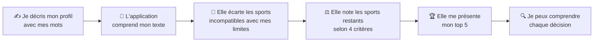
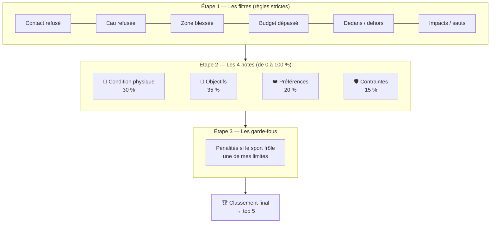
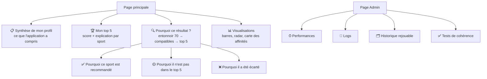
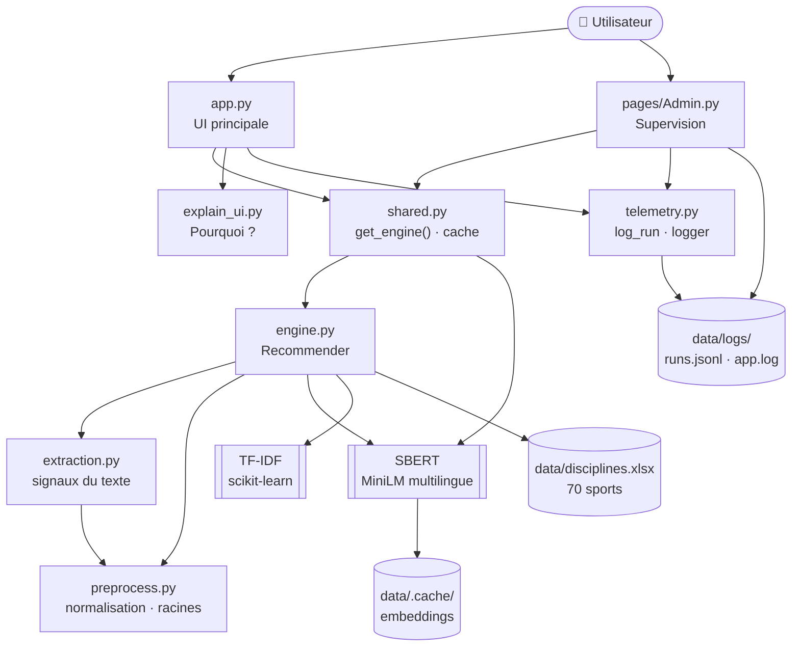
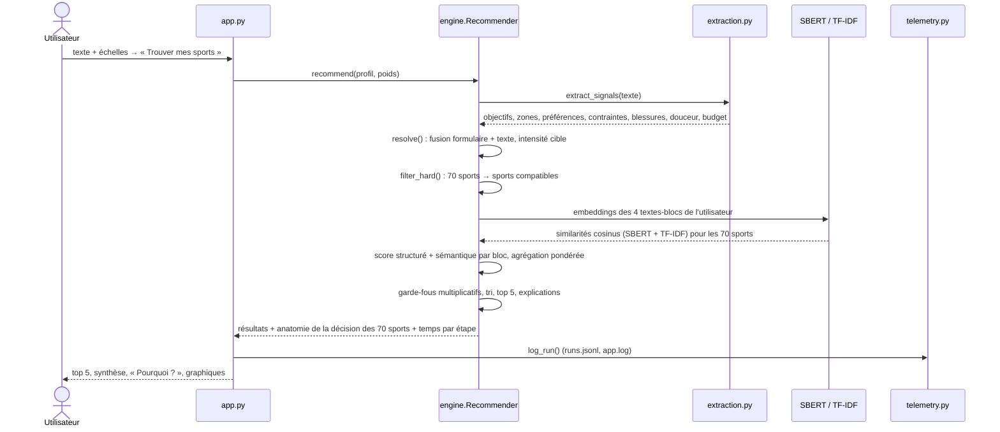
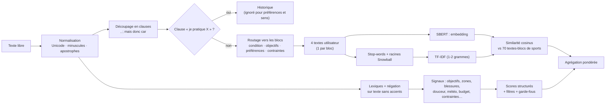

# 🏃 ECE-Projet-NLP — Recommandation intelligente d'activités sportives

> **Thème 7** — Recommandation d'activités sportives fondée sur l'analyse sémantique du profil physique et des objectifs personnels.
> L'utilisateur décrit son profil **avec ses propres mots** ; le système le comprend (NLP), le compare à 70 disciplines et
> propose un **top 5 expliqué**, avec la possibilité de voir *pourquoi* chaque sport est recommandé ou écarté.
>
> ⚠️ Outil d'aide à la **découverte** d'activités. Ce n'est ni un diagnostic médical ni une prescription d'exercices.

| | |
|---|---|
| **Entrée** | un texte libre + 4 échelles rapides (endurance, force, mobilité, motivation) + niveau + disponibilité |
| **Sortie** | top 5 des sports, scores par bloc, explications, visualisations, tableau de décision des 70 sports |
| **NLP** | prétraitement FR, extraction par lexiques + négation, SBERT multilingue, TF-IDF, similarité cosinus |
| **Stack** | Python 3.12 · Streamlit · sentence-transformers · scikit-learn · NLTK · pandas · Plotly |

---

## Sommaire

1. [Démarrage rapide](#1-démarrage-rapide)
2. [Architecture fonctionnelle](#2-architecture-fonctionnelle-comment-ça-marche-sans-technique)
3. [Architecture technique](#3-architecture-technique)
4. [Calculs détaillés](#4-calculs-détaillés)
5. [Données](#5-données)
6. [Panneau d'administration et tests](#6-panneau-dadministration-et-tests)
7. [Limites et pistes d'évolution](#7-limites-et-pistes-dévolution)

---

## 1. Démarrage rapide

```bash
pip install -r requirements.txt
streamlit run app.py
```

Le premier lancement télécharge le modèle SBERT (`paraphrase-multilingual-MiniLM-L12-v2`, ~470 Mo) et met en cache les
embeddings des 70 sports dans `data/.cache/`. Sans modèle (hors-ligne), l'application bascule automatiquement sur TF-IDF seul.

- **Page principale** : questionnaire → top 5 → section « Pourquoi ce résultat ? » → visualisations.
- **Page Admin** (menu latéral) : supervision, logs, historique, tests. Mot de passe optionnel via `ADMIN_PASSWORD`.

---

## 2. Architecture fonctionnelle (comment ça marche, sans technique)

### 2.1 Le parcours de l'utilisateur



### 2.2 Ce que l'application comprend de mon texte

Je n'ai pas à cocher de cases : l'application lit mes phrases et en déduit ce qui compte.

| Ce que j'écris | Ce que l'application en déduit |
|---|---|
| « Je me fatigue vite quand je cours » | mon endurance est plus faible que ce que j'ai indiqué |
| « Je veux améliorer mon endurance et renforcer mon dos » | **objectifs** : endurance, force, zone du dos |
| « Je préfère les activités individuelles, en intérieur » | **préférences** : individuel, intérieur |
| « Je ne veux pas de sport de contact / je ne sais pas nager » | **contraintes strictes** : contact et eau exclus |
| « Je me suis blessé à l'épaule » | **blessure** : tout sport qui sollicite l'épaule est écarté |
| « Je cherche quelque chose de calme et doux » | **pratique douce** : l'intensité est plafonnée |
| « Mon budget est de 15 euros par séance » | **budget** : les sports trop chers sont écartés |
| « Je pratique le tennis » | simple **historique**, pas une préférence (le tennis n'est pas favorisé) |
| « Je ne veux pas d'activité dans l'eau » | la **négation** est comprise : l'eau n'est pas un goût |

### 2.3 Les trois étapes de décision



1. **Les filtres** retirent *avant tout calcul* les sports que je ne peux ou ne veux pas pratiquer. Un sport écarté n'est jamais classé.
2. **Les 4 notes** mesurent, pour chaque sport restant :
   - 💪 **Condition physique** : l'effort demandé est-il adapté à mon niveau ?
   - 🎯 **Objectifs** : le sport développe-t-il ce que je veux travailler ?
   - ❤️ **Préférences** : correspond-il à mes goûts (seul / équipe, intérieur / extérieur, type d'activité) ?
   - 🛡️ **Contraintes** : respecte-t-il mes limites (chocs, zones fragiles, budget, rythme) ?

   Chaque note combine **des règles** (comparaison avec les fiches du jeu de données) et **la ressemblance de sens** entre mon texte et la description du sport.
3. **Les garde-fous** réduisent le score d'un sport qui, sans être interdit, frôle une de mes limites (ex. : intensité trop haute pour une pratique douce).

### 2.4 Ce que je vois à l'écran



La section **« Pourquoi ce résultat ? »** permet de choisir *n'importe quel* des 70 sports :

| Statut | Ce que l'écran montre |
|---|---|
| ✅ **Recommandé** | graphique en cascade du score (apport de chaque bloc, pénalités, total), détail critère par critère (🟢🟠🔴) |
| 🟡 **Compatible mais non retenu** | l'écart avec le 5ᵉ sport, bloc par bloc : *pourquoi pas dans le top 5 ?* |
| ❌ **Écarté** | la ou les règles qui l'ont retiré, formulées en français, et la fiche du sport |

---

## 3. Architecture technique

### 3.1 Arborescence

```text
projet/
├── app.py                 # Page principale Streamlit (formulaire, top 5, visualisations)
├── pages/
│   └── Admin.py           # Centre de contrôle (runtime, logs, replay, carte PCA, labo, tests)
├── explain_ui.py          # Interface « Pourquoi ce résultat ? » (cascade, détail, comparaison)
├── engine.py              # Cœur : profil → filtrage → scores par blocs → pénalités → classement
├── extraction.py          # Extraction d'indices dans le texte (lexiques, négation, blessure, douceur…)
├── preprocess.py          # Normalisation, tokenisation, stop-words FR, racinisation Snowball
├── shared.py              # Chargement unique du modèle SBERT et du moteur (cache Streamlit)
├── telemetry.py           # Journalisation : runs (JSONL) + logs applicatifs
├── data/
│   ├── disciplines.xlsx   # 70 sports × 26 champs (+ feuille « Guide des champs »)
│   ├── .cache/            # embeddings SBERT mis en cache (non versionné)
│   └── logs/              # runs.jsonl, app.log (non versionnés)
├── .streamlit/config.toml
└── requirements.txt
```

### 3.2 Interaction entre les blocs



| Module | Responsabilité | Dépend de |
|---|---|---|
| `preprocess.py` | normaliser le texte (Unicode, minuscules), tokeniser, retirer les stop-words, raciniser | NLTK |
| `extraction.py` | repérer objectifs, zones, préférences, contraintes, blessures, douceur, budget ; router les clauses vers les blocs | `preprocess` |
| `engine.py` | résoudre le profil, filtrer, calculer scores structurés + sémantiques, pénaliser, classer, expliquer | `extraction`, `preprocess`, scikit-learn, pandas |
| `shared.py` | instancier **une seule fois** SBERT + moteur (`st.cache_resource`), repli TF-IDF si SBERT indisponible | `engine` |
| `explain_ui.py` | rendre la décision de chaque sport lisible (cascade, critères, comparaison avec le 5ᵉ) | `engine` |
| `telemetry.py` | écrire chaque run (profil, signaux, top 5, exclus, temps) et les logs | — |
| `app.py` / `Admin.py` | interfaces | tous les précédents |

### 3.3 Déroulé d'une requête



### 3.4 Pipeline NLP



| Technique | Où | Rôle |
|---|---|---|
| Normalisation Unicode, minuscules | `preprocess.normalize` | texte propre |
| Suppression des accents | `preprocess.fold` | lexiques robustes (« épaule » = « epaule ») |
| Stop-words FR + racinisation Snowball | `preprocess.preprocess` | entrée du TF-IDF |
| Lexiques regex + **détection de négation** | `extraction.extract_signals` | « pas de contact » ≠ « contact » |
| Distinction objectif / douleur / historique | `extraction` | « renforcer mon dos » ≠ « mal au dos » ≠ « je pratique le tennis » |
| **SBERT** (embeddings de phrases) | `engine._cached_embed` | sens du texte vs descriptions |
| **TF-IDF** + cosinus | `engine.sem_scores` | recoupement lexical (complément) |
| Phrase utilisateur la plus proche | `engine._best_sentences` | explicabilité sémantique |

### 3.5 Modèle de données de la décision

`Recommender.recommend()` renvoie un dictionnaire dont l'entrée `anatomy` contient, **pour chacun des 70 sports** :

```text
sport_id, name
retained        True/False            → a passé les filtres ?
rank, in_top    rang parmi les retenus, appartenance au top 5
excluded_why    [raisons]             → filtres déclenchés
blocks          {bloc: note 0–1}      → note finale du bloc
struct / sem    {bloc: 0–1}           → part « règles » et part « sens du texte »
weights         {bloc: poids normalisé}
contrib         {bloc: note × poids}  → apport au score (cascade)
base, pen_factor, pen_why             → score avant pénalités, facteur, raisons
criteria        {bloc: [(critère, 0–1)]}
```

C'est cette structure qui alimente l'écran « Pourquoi ? » **et** les logs : l'explication affichée est exactement le calcul réalisé.

---

## 4. Calculs détaillés

### 4.1 Score final

$$
\text{Score} \;=\; \underbrace{\frac{\sum_{b} w_b \, v_b}{\sum_{b} w_b}}_{\text{moyenne pondérée des blocs}} \;\times\; \underbrace{\prod_k \pi_k}_{\text{garde-fous}}
\qquad b \in \{\text{condition, objectifs, préférences, contraintes}\}
$$

| Bloc | Poids par défaut $w_b$ | Justification |
|---|---|---|
| 🎯 Objectifs | **35 %** | motif principal de la recherche |
| 💪 Condition physique | **30 %** | faisabilité et sécurité |
| ❤️ Préférences | **20 %** | adhésion à long terme |
| 🛡️ Contraintes | **15 %** | déjà traitées en amont par le filtrage dur |

Les poids sont réglables dans la barre latérale (renormalisés pour sommer à 100 %). Un bloc sans information (par exemple aucune
préférence exprimée) est ignoré et les poids restants sont renormalisés.

### 4.2 Note d'un bloc

$$
v_b = 0{,}4 \cdot S_b + 0{,}6 \cdot M_b
\qquad
M_b = 0{,}7 \cdot \text{minmax}\big(\cos_{\text{SBERT}}\big) + 0{,}3 \cdot \text{minmax}\big(\cos_{\text{TF-IDF}}\big)
$$

- $S_b$ : score **structuré** (règles, voir 4.3) ;
- $M_b$ : score **sémantique** ; le cosinus entre le texte utilisateur du bloc et le texte-bloc de chaque sport est normalisé
  (min-max) sur les 70 sports, car les cosinus SBERT sont tous dans une plage étroite ;
- si $S_b$ ou $M_b$ est absent, l'autre est utilisé seul.

### 4.3 Scores structurés $S_b$

**💪 Condition physique**

$$
S_{cond} = 0{,}5\,F_{cap} + 0{,}25\,F_{niv} + 0{,}25\,F_{int}
$$

| Terme | Formule |
|---|---|
| $F_{cap}$ (exigences vs capacités) | $1-\operatorname{moy}_{c\in\{\text{endurance, force, souplesse}\}} \dfrac{\max\big(0,\;\text{req}_c-(\text{capacité}_c+1)\big)}{4}$ |
| $F_{niv}$ (difficulté vs niveau) | $1 - 0{,}35\cdot\max(0,\;\text{difficulté} - \text{difficulté tolérée})$ (1 pour débutant, 2 pour occasionnel, 3 au-delà) |
| $F_{int}$ (intensité vs cible) | $1-\Big(\dfrac{\max(0,\Delta-0{,}5)}{3}+\dfrac{\max(0,-\Delta-1)}{4}\Big)$ avec $\Delta=\text{intensité}-\text{cible}$ |

L'**intensité cible** est $\text{clip}\big(1+0{,}5\cdot\text{endurance}+0{,}5\cdot\text{niveau}+0{,}25\cdot(\text{motivation}-3),\,1,\,5\big)$,
plafonnée à 2 si une pratique douce est demandée. Les capacités saisies sont ajustées de ±1 si le texte dit « je me fatigue vite »,
« bonne endurance », etc.

**🎯 Objectifs** : moyenne, sur chaque objectif détecté, d'un score de correspondance :
étiquette `objectifs` du sport (1,0) ; sinon capacité sollicitée / 5 (endurance, force, souplesse, équilibre, coordination) ;
règles dédiées (détente ↔ intensité ≤ 2, plein air ↔ extérieur, jeu collectif ↔ équipe/groupe…). Une zone du corps à travailler
compte pour $0{,}5+0{,}5\cdot\text{force}/5$ si le sport la sollicite, 0 sinon.

**❤️ Préférences** : moyenne de composantes à 1 ou 0 : format (individuel / duo / équipe / groupe), environnement,
familles d'activités aimées ; une famille ou un format rejeté dans le texte compte 0.

**🛡️ Contraintes (partie souple)** : moyenne de : impacts selon la tolérance, zones à ménager épargnées, contact (si refusé),
budget, rythme (séances fréquentes + effort/impacts élevés → 0,6).

### 4.4 Filtres stricts (avant tout score)

| Règle | Sport écarté si… |
|---|---|
| Contact refusé | contact « réglementé » |
| Eau refusée | catégorie aquatique / nautique / pagaie / rame / voile |
| Articulations fragiles | impacts = 3 (fréquents) |
| Sauts à éviter | catégorie « saut » |
| Intérieur (ou météo) / extérieur | sport pratiqué uniquement dans l'autre environnement |
| Zone blessée | le sport sollicite cette zone *(assouplie aux sports très doux si moins de 5 sports restent, avec avertissement ⚠)* |
| Zone à ménager (déclarée) | zone sollicitée **et** (impacts = 3 ou force ≥ 4) |
| Budget | coût minimal de séance > plafond |
| Pratique douce | intensité ≥ 4 ou impacts = 3 |

### 4.5 Garde-fous multiplicatifs $\pi_k$

Ils empêchent qu'une limitation déclarée soit « diluée » dans la moyenne des blocs.

| Situation | Facteur |
|---|---|
| Articulations fragiles + impacts = 2 | ×0,85 |
| Articulations fragiles + sauts | ×0,85 |
| Impacts fréquents (tolérance moyenne) | ×0,92 |
| Zone à ménager sollicitée | ×(1 − 0,06 par zone) |
| Zone blessée sollicitée | ×0,8 (×0,6 en mode assoupli) |
| Pratique douce + intensité ≥ 4 / = 3 | ×0,75 / ×0,92 |
| Pratique douce + force ≥ 4 / sauts / impacts = 2 | ×0,9 / ×0,85 / ×0,92 |
| Intensité ≥ 4 alors que la cible ≤ 2,5 | ×0,9 |
| Débutant + difficulté d'entrée maximale | ×0,9 |
| Famille d'activités aimée non respectée | ×0,85 |
| Format souhaité non respecté | ×0,92 |

### 4.6 Classement

Tri par `(touche la zone blessée, −score)` : en mode assoupli, les sports qui sollicitent la zone blessée passent toujours après les autres.

### 4.7 Exemple chiffré

Texte : *« Je me suis blessé à l'épaule, je cherche un sport calme et doux, en intérieur… »* → **Danse sportive standard** (n°1) :

| Bloc | Note | Poids | Apport |
|---|---|---|---|
| 💪 Condition physique | 69 % | 0,30 | +20,7 |
| 🎯 Objectifs | 23 % | 0,35 | +7,9 |
| ❤️ Préférences | 53 % | 0,20 | +10,6 |
| 🛡️ Contraintes | 67 % | 0,15 | +10,1 |
| 🚧 Garde-fous | | | −3,9 |
| **Score final** | | | **45,4 %** |

Cette décomposition est exactement celle du graphique en cascade de l'écran « Pourquoi ? ».

### 4.8 Performances

Une recommandation prend ~100 à 200 ms (embeddings des sports précalculés et mis en cache ; seul le texte utilisateur est encodé).
Le temps par étape (extraction, filtrage, embeddings + cosinus, scoring, explications) est consigné dans chaque run
et affiché dans la page Admin.

---

## 5. Données

`data/disciplines.xlsx` : **70 disciplines** × 26 champs (voir la feuille « Guide des champs »).

| Famille de champs | Exemples |
|---|---|
| Identité | `sport_id`, `nom_sport`, `categories` |
| Texte (pour le sémantique) | `description_fr`, `mots_cles`, `lieu_pratique` |
| Échelles ordinales 1–5 | `endurance`, `force`, `souplesse`, `coordination`, `equilibre`, `intensite_loisir` |
| Échelles 1–3 | `difficulte_entree`, `impacts` |
| Étiquettes multi-valeurs (`\|`) | `zones_corps_sollicitees`, `objectifs`, `format_pratique`, `environnement` |
| Contraintes | `contact`, `equipement`, budgets séance et matériel |

Pour le sémantique, chaque sport est décrit par **4 textes-blocs** générés à partir de ces champs (condition, objectifs,
préférences, contraintes), de sorte que chaque bloc de l'utilisateur est comparé à un texte de même nature.

> Les annotations sont celles d'un prototype pédagogique, **non validées médicalement**.

---

## 6. Panneau d'administration et tests

Page **Admin** (menu latéral) :

| Onglet | Contenu |
|---|---|
| 📡 Vue d'ensemble | sports les plus recommandés, signaux fréquents, motifs de filtrage, recoupement des méthodes |
| ⏱️ Runtime | temps par étape et par run, distribution des latences |
| 🗂️ Historique & replay | chaque run avec ses signaux ; **rejeu** avec le code actuel pour détecter les régressions |
| 📜 Logs | lecture en direct, filtres, téléchargement |
| 🗺️ Carte des sports | projection PCA des embeddings, texte utilisateur superposé |
| 🎛️ Labo de sensibilité | variation des poids et mouvement du classement (▲ ▼ 🆕) |
| ✅ Tests | **9 scénarios de cohérence** (genou fragile, ne sait pas nager, pas de contact, budget, blessure à l'épaule, tendinite au coude, combat, collectif, exemple de l'énoncé) |
| 🧬 Dataset | statistiques et exploration des 70 sports |

Les runs sont écrits dans `data/logs/runs.jsonl` et les logs dans `data/logs/app.log` (non versionnés).

---

## 7. Limites et pistes d'évolution

**Limites connues**

- Jeu de données restreint : 70 sports, pas de yoga ni de pilates ; un profil très contraint (blessure + pratique douce + intérieur) laisse peu de candidats.
- L'extraction est à base de lexiques : une tournure inhabituelle peut ne pas être détectée (la synthèse du profil montre toujours ce qui a été compris).
- Les scores sont relatifs à un jeu de 70 sports (normalisation min-max) : ils servent à classer, pas à mesurer une « adéquation absolue ».
- Annotations non validées médicalement.

**Extensions envisagées** (le moteur fonctionne indépendamment) : chatbot d'affinage, explications par LLM, RAG sur une base documentaire,
agent proposant des alternatives, résumé structuré du profil.
